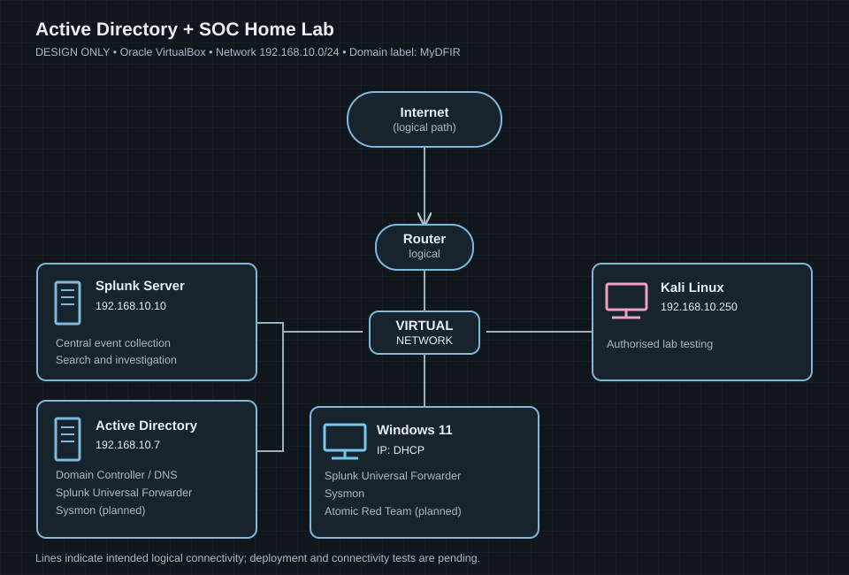

# Active Directory & SOC Home Lab

## Project overview

This repository documents the design and progressive implementation of a virtual Active Directory and security monitoring environment. The goal is to demonstrate hands-on skills in identity administration, Windows security, telemetry collection, Splunk analysis and controlled security testing.

**Hypervisor:** Oracle VirtualBox  
**Current status:** Milestone 01 (network design) completed. Virtual machines, domain services, log forwarding and security testing are not yet verified as implemented.

### Planned network

*The SVG is a clean GitHub-renderable recreation of the supplied design diagram; the original PNG is retained separately.*

| System | Planned address | Intended role |
| --- | --- | --- |
| Active Directory server | 192.168.10.7 | Domain controller, DNS and Splunk Universal Forwarder / Sysmon |
| Splunk server | 192.168.10.10 | Central security event collection and analysis |
| Windows 11 client | DHCP | Domain workstation, Splunk Universal Forwarder, Sysmon and Atomic Red Team |
| Kali Linux | 192.168.10.250 | Authorised lab security testing |
| Lab network | 192.168.10.0/24 | Shared virtual subnet |

The supplied diagram names the domain **MyDFIR**. Its actual AD DNS name and the VirtualBox virtual networking configuration will be documented after configuration.

### Project milestones

- [x] **01 — Network design:** Planned topology, addressing and machine roles documented. [Documentation](docs/01-Network-Design.md)
- [ ] **02 — VirtualBox setup:** Build the VMs, configure networking and validate connectivity.
- [ ] **03 — Active Directory:** Install AD DS, configure DNS and verify domain services.
- [ ] **04 — Windows endpoint:** Join Windows 11 to the domain and validate sign-in.
- [ ] **05 — SIEM telemetry:** Install/configure Sysmon and Splunk Universal Forwarders; confirm events reach Splunk.
- [ ] **06 — Security testing:** Generate controlled, authorised test activity and investigate events.
- [ ] **07 — Review:** Summarise evidence, troubleshooting, lessons learned and improvement opportunities.

### Documentation approach

For each milestone, record **the problem, the implementation decision, what was done, how it was verified and what could be improved**. Evidence and test results will distinguish planned activities from demonstrated work. No credentials, private keys or other secrets will be committed.

### Tutorial acknowledgement

The guided starting point is [Active Directory Project (Home Lab) — Part 1](https://www.youtube.com/watch?v=mWqYyl89QaY). This is a tutorial-guided project; independent changes and testing will be identified as the lab develops.
