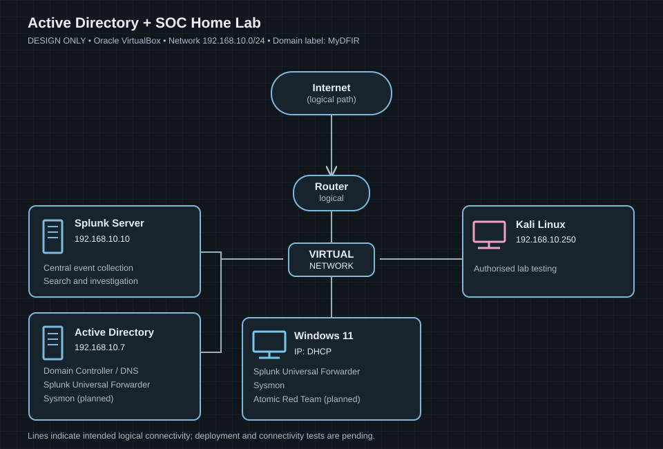

# Milestone 01 — Network architecture and IP address planning

**Status:** Design completed; infrastructure and connectivity are not yet validated.  
**Hypervisor selected:** Oracle VirtualBox.

## Objective and problem

Plan a small virtual network that can support centralised Windows domain authentication and security event collection. Before building virtual machines, roles, addresses and traffic paths need to be defined to reduce configuration errors, IP conflicts and unnecessary troubleshooting.

## Work completed

Created a network topology showing a single proposed **192.168.10.0/24** subnet, an Internet-facing logical router/switch path, and four planned lab systems:

| Component | Planned IP | Intended function |
| --- | --- | --- |
| Active Directory server | 192.168.10.7 | Domain services; Sysmon and Splunk Universal Forwarder telemetry |
| Splunk server | 192.168.10.10 | Central log ingestion, search and alerting |
| Windows 11 client | DHCP | Domain-joined endpoint, Sysmon, log forwarding and Atomic Red Team |
| Kali Linux | 192.168.10.250 | Controlled lab-only security tests |

The diagram labels the domain **MyDFIR**. The actual DNS name will be confirmed during AD DS configuration.

## Design evidence

**Evidence ID:** EVD-01  
**Evidence type:** Design diagram (SVG recreation of the user's original PNG).

**This proves:** Network roles, intended communication paths and planned IPs were mapped before deployment.  
**This does not prove:** Working VMs, connectivity, DNS, domain membership, log ingestion or successful security tests.

## Implementation decisions to validate during Milestone 02

1. **Virtual networking:** A VirtualBox NAT Network may support VM-to-VM traffic and outbound Internet access. Confirm the tutorial's actual configuration and test isolation from the physical home network. The drawn router/switch may be logical symbols, not actual deployed appliances.
2. **IP address allocation:** Reserve static server addresses (192.168.10.7, .10 and .250) outside any configured DHCP range.
3. **Domain and DNS:** Decide and record the actual AD DS domain FQDN, DNS server and client DNS settings rather than assuming that the diagram's "MyDFIR" label is a DNS FQDN.
4. **Telemetry path:** Validate Sysmon / Windows event collection into Splunk through Universal Forwarders after deployment.
5. **Test isolation:** Keep Kali security testing inside an authorised lab and consider stronger segmentation after the initial tutorial implementation.

## Planned validation (not yet completed)

- [ ] Verify VirtualBox network mode, address space and NAT/DHCP settings.
- [ ] Check each VM's IPv4 address, subnet, DNS and gateway.
- [ ] Test permitted connectivity among VMs.
- [ ] Validate AD DS and DNS services.
- [ ] Confirm Windows 11 domain membership and domain logon.
- [ ] Confirm Splunk ingestion from the intended Windows systems.
- [ ] Confirm testing remains restricted to lab systems.

## Lessons learned

A diagram provides a useful baseline for design decisions and later troubleshooting but must not be confused with operational evidence. Each planned connection and service must subsequently be tested and documented.

## Possible improvement

Once the baseline lab works, evaluate separating Kali Linux from the identity and monitoring systems through virtual-network segmentation and narrowly scoped firewall access. Whether this is worthwhile depends on learning objectives and VirtualBox resource limits.

## Tutorial credit

Guided reference: [Active Directory Project (Home Lab) — YouTube](https://www.youtube.com/watch?v=mWqYyl89QaY). Tutorial guidance and independent implementation work will be distinguished as later milestones are completed.
